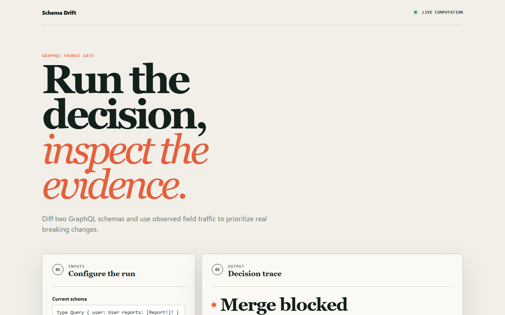
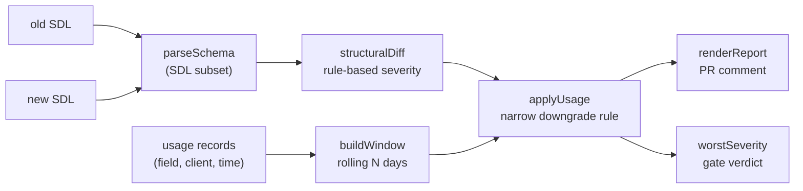

# schemadrift

A GraphQL breaking-change gate that downgrades severity using real field-usage telemetry, so the gate stays worth reading.

[](https://github.com/SlateGitOrg/schemadrift/actions/workflows/ci.yml)
[Live demo](https://slategitorg.github.io/schemadrift/)



## Why

Schema checks flag every removed field as breaking. Teams then either block harmless deletions for months or learn to click through the warning, at which point the gate has stopped working while still appearing in every CI run.

schemadrift classifies each change against field-usage telemetry over a rolling window. Removing a deprecated field with zero requests in 30 days is SAFE. Removing a field that a client still calls is BREAKING, and the report names that client.

## Features

- Structural diff of two SDL documents into a typed change list (removed or retyped fields, nullability changes, added arguments, new required input fields, added and removed types).
- Usage ingestion: records of `{ field, client, at }` reduced to the callers seen per field inside a configurable window.
- Narrow downgrade rule: only removals of deprecated fields with zero callers become SAFE.
- Every downgrade is recorded on the finding (`downgradedFrom`, `justification`) and shown in the report.
- Markdown report suitable for a pull request comment, plus an overall verdict (worst severity).
- Browser app in `site/` running the same logic, deployed to GitHub Pages.

## Architecture



Two small modules do the work. `src/diff.ts` parses SDL and produces base severities; `src/usage.ts` applies usage evidence and renders the result. See [docs/ARCHITECTURE.md](docs/ARCHITECTURE.md) for the decisions behind them.

## Quick start

Requires Node 22.18+ (Node 24 recommended). TypeScript runs through Node's built-in type stripping, so there is no build step and no dependencies to install.

```bash
git clone https://github.com/SlateGitOrg/schemadrift.git
cd schemadrift
npm run demo
npm test
```

On Node 22.6 to 22.17, set `NODE_OPTIONS=--experimental-strip-types` before running either command.

## Example

`npm run demo` judges one schema change twice, first on structure alone and then with usage evidence (output trimmed):

```text
  structure only:  BREAKING  (2 breaking)
  with usage:      SAFE  (0 breaking)

  field                 structural   with usage   why
  User.nickname         BREAKING     SAFE         deprecated + 0 calls in 30d
  User.avatarUrl        BREAKING     SAFE         deprecated + 0 calls in 30d

    **SAFE** (3)

    - [o] `User.nickname` - FIELD_REMOVED _(was BREAKING: deprecated, and zero calls from any client in the last 30 days)_
```

Programmatic use:

```ts
import { parseSchema, structuralDiff } from './src/diff.ts';
import { buildWindow, applyUsage, worstSeverity, renderReport } from './src/usage.ts';

const oldS = parseSchema(oldSdl);
const changes = structuralDiff(oldS, parseSchema(newSdl));
const final = applyUsage(changes, oldS, buildWindow(records, Date.now(), 30));
console.log(worstSeverity(final), renderReport(final));
```

## How it works

- **Parsing.** A dependency-free parser handles `type`, `input`, `enum` and `interface` bodies. Newlines, commas and whitespace all separate fields, and argument lists are masked first so their colons are not read as fields.
- **Structural rules.** Removed types and fields and changed field types are BREAKING. An output field becoming non-null is SAFE, while an input field becoming required (or a new required input field) is BREAKING. Added arguments are DANGEROUS.
- **Usage rule.** A BREAKING `FIELD_REMOVED` with callers stays BREAKING and lists them. With no callers and no prior `@deprecated`, it stays BREAKING with an explanation, since clients had no warning. With no callers and a prior `@deprecated`, it becomes SAFE with the reason attached.

## Testing

```bash
npm test
```

`tests/severity.test.ts` covers the parser, the downgrade rule (including severity changing as the usage window empties and a single remaining caller blocking a downgrade), structural edge cases, and the report. `site/core.test.mjs` tests the browser logic, and CI also runs `scripts/validate_site.py`.

## Project layout

```text
src/diff.ts          SDL parser and structural diff
src/usage.ts         usage window, downgrade rule, report
src/demo.ts          runnable example
tests/               severity tests
site/                browser app (GitHub Pages)
docs/ARCHITECTURE.md design notes
```

## Limitations

- The parser covers a subset of SDL; unions, scalars, directive definitions and `extend` blocks are not modeled.
- It is a library plus demo, not a CLI or GitHub Action; usage records must be supplied by the caller.
- Zero recorded calls is only as trustworthy as the telemetry behind it.

## License

MIT — see [LICENSE](LICENSE).
