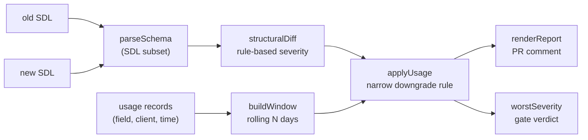

# Architecture

## Context

Schema diff tools classify every removed GraphQL field as breaking. On a schema with many deprecated fields this produces a constant stream of alerts that teams learn to override. schemadrift keeps the structural diff but adds a second input, observed field usage, so that the severity of a removal reflects whether anyone still calls the field.

## Components

- `src/diff.ts`: a small dependency-free SDL parser (types, inputs, enums, interfaces, nullability, `@deprecated`, argument names) and `structuralDiff`, which emits a typed change list with a base severity.
- `src/usage.ts`: `buildWindow` reduces usage records to the set of callers per field inside the lookback window; `applyUsage` adjusts severity; `renderReport` and `worstSeverity` produce the output.
- `site/`: a browser build of the same decision logic (`core.mjs`) with a form UI, deployed to GitHub Pages.

## Key decisions

**Usage can only downgrade one kind of change.** Only `FIELD_REMOVED` findings that are currently BREAKING are considered. A removal is downgraded to SAFE only when the field was marked `@deprecated` and has zero callers in the window. Alternatives considered: downgrading when a field has "few" callers, or ignoring deprecation. Both make the gate judge how much breakage is acceptable, which is exactly what people stop trusting.

**A removal that still has callers stays BREAKING and names them.** The report lists the clients, which turns a refusal into an action: talk to that team.

**A field that was never deprecated stays BREAKING even with zero callers.** Clients got no warning, and an empty window can also mean missing telemetry. The justification is recorded on the finding.

**Downgrades are never silent.** Every adjusted finding carries `downgradedFrom` and a `justification`, and both appear in the rendered report.

**Own parser.** The gate needs only a small SDL subset, so the parser is about a hundred lines with no dependencies. Newlines, commas and plain whitespace are all treated as field separators, and argument lists are masked before field extraction so colons inside them are not read as fields.

**Input versus output nullability.** An output field becoming non-null is SAFE for clients; an input field becoming required, or a new required input field, is BREAKING.

## Failure modes

- Empty or missing telemetry looks the same as "no callers". The deprecation requirement limits the damage, but the lookback window must be long enough to cover real traffic.
- The parser covers a subset of SDL. Unions, scalars, directives definitions, `extend` blocks and descriptions with braces are not modeled.

## Out of scope

Schema registry features, versioning, composition across subgraphs, and fetching telemetry from a gateway.
